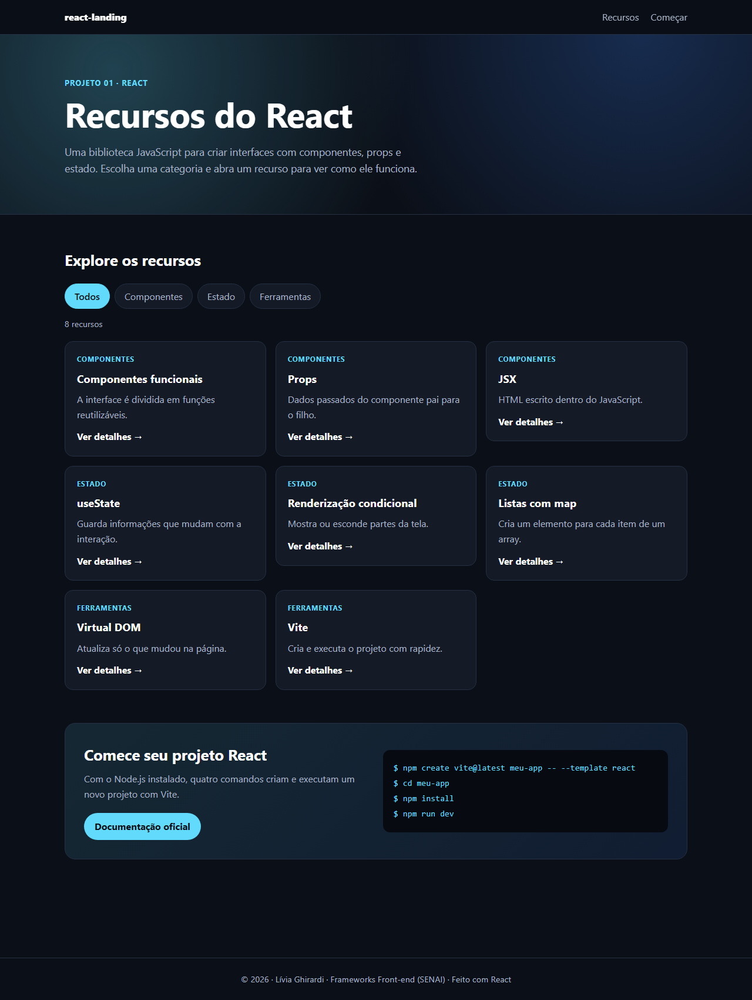
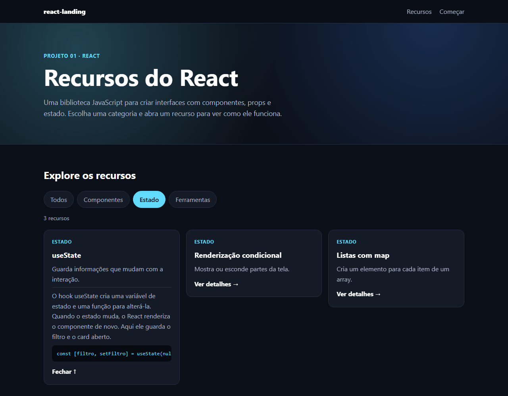

# Recursos do React — Projeto 01

Projeto React da atividade **Projetos com Frameworks Front-end (Aula 03)** da disciplina **Frameworks Front-end (SENAI)**.

A página apresenta os principais recursos do React. O usuário filtra os recursos por categoria e abre cada card para ver uma explicação e um exemplo de código.

**Aplicação online:** https://react-landing-senai.vercel.app

## Prints





## Componentes

| Componente | Função |
|------------|--------|
| `App` | Componente raiz que monta a página |
| `Header` | Barra de navegação fixa no topo |
| `Hero` | Título e subtítulo, recebidos do `App` por props |
| `ListaRecursos` | Filtro por categoria e lista de recursos (guarda o estado com `useState`) |
| `RecursoCard` | Card de cada recurso; avisa a lista pela função `onAlternar` quando é aberto |
| `Comecar` | Chamada para começar um projeto, com os comandos do Vite |
| `Footer` | Rodapé |

Os dados ficam em `src/data/recursos.js`.

## Conceitos utilizados

- **Componentes funcionais** e **JSX**
- **Props** para passar dados e funções do pai para o filho
- **`useState`** para o filtro e o card aberto
- **Listas com `map`** e a prop `key`
- **Renderização condicional** com `&&` e operador ternário

## Tecnologias

- [React](https://react.dev) 19
- [Vite](https://vite.dev) 8
- [Oxlint](https://oxc.rs) para análise do código
- [Vercel](https://vercel.com) para deploy e hospedagem

## Como rodar localmente

É preciso ter o [Node.js](https://nodejs.org) instalado.

```bash
npm install     # instala as dependências
npm run dev     # inicia o servidor local
npm run build   # gera a versão de produção na pasta dist
```

## Deploy

O repositório está conectado à Vercel. Cada `git push` na branch `main` publica uma nova versão automaticamente em https://react-landing-senai.vercel.app.

## Versões

O projeto segue o Versionamento Semântico (MAJOR.MINOR.PATCH). As versões publicadas estão em [Releases](https://github.com/liviaghirardi/React/releases).

- **1.0.0**: primeira versão estável
- **1.1.0**: página "Recursos do React" dividida em componentes, com filtro por categoria e cards que abrem os detalhes
